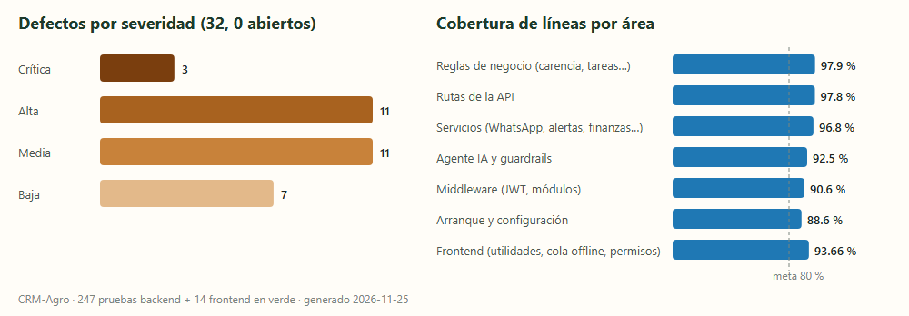

# Métricas de calidad · CRM-Agro

Generado con `node evidencias/pruebas/fuente/generar_metricas.mjs` el 2026-11-25 a partir de los reportes reales de cobertura y del reporte de defectos.



## Pruebas automatizadas

| Suite | Herramienta | Pruebas | Resultado |
|---|---|---|---|
| Backend: unitarias + API (supertest sobre SQLite de prueba) | Vitest + @vitest/coverage-v8 | 247 | ✅ todas en verde (`resultado_pruebas_backend.txt`) |
| Frontend: utilidades, cola offline, permisos, CSV | Vitest (jsdom) | 14 | ✅ todas en verde (`resultado_pruebas_frontend.txt`) |

## Cobertura del backend

| Métrica | Valor | Meta |
|---|---|---|
| Líneas | **95.97 %** | ≥ 80 % |
| Sentencias | 95.97 % | — |
| Funciones | 95.13 % | ≥ 85 % |
| Ramas | 79.92 % | ≥ 75 % |

Lógica crítica (umbral ≥ 90 % de líneas fijado en `vitest.config.js`; si baja, el CI falla):

| Archivo | Líneas |
|---|---|
| `src/agente/agente.js` | 100 % |
| `src/agente/guardrails.js` | 100 % |
| `src/agente/parser.js` | 98.79 % |
| `src/agente/politicas.js` | 100 % |
| `src/utils/carencia.js` | 95.83 % |
| `src/utils/tareas.js` | 100 % |
| `src/utils/vivero.js` | 100 % |
| `src/services/finanzas.js` | 100 % |
| `src/services/trazabilidad.js` | 100 % |
| `src/routes/ventas.js` | 96.68 % |

Por área:

| Área | Líneas |
|---|---|
| Reglas de negocio (carencia, tareas…) | 97.9 % |
| Rutas de la API | 97.8 % |
| Servicios (WhatsApp, alertas, finanzas…) | 96.8 % |
| Agente IA y guardrails | 92.5 % |
| Middleware (JWT, módulos) | 90.6 % |
| Arranque y configuración | 88.6 % |
| Frontend (utilidades, cola offline, permisos) | 93.66 % |

> La cobertura del frontend mide la lógica (`src/utils`). Las vistas Vue se validan con los casos de aceptación (`casos_uat.md`) y las pruebas manuales del plan.

## Defectos por severidad

| Severidad | Cantidad | Abiertos |
|---|---|---|
| Crítica | 3 | 0 |
| Alta | 11 | 0 |
| Media | 11 | 0 |
| Baja | 7 | 0 |
| **Total** | **32** | **0** |

Detalle en `reporte_defectos.csv`. Origen de los defectos de esta etapa: la mayoría (DEF-15 a DEF-32) se encontraron al **escribir las pruebas de API y las pruebas de humo de la demo** — por ejemplo DEF-17 (crítico: una pregunta de dosis con un nombre comercial no se bloqueaba) y DEF-29 (el detalle de venta respondía 500).

## Cómo reproducir

```powershell
cd codigo/backend ; npm run test:cov     # crea prisma/test.db sola, ejecuta y mide
cd ../frontend ; npm run test:cov
cd ../.. ; node evidencias/pruebas/fuente/generar_metricas.mjs
```
