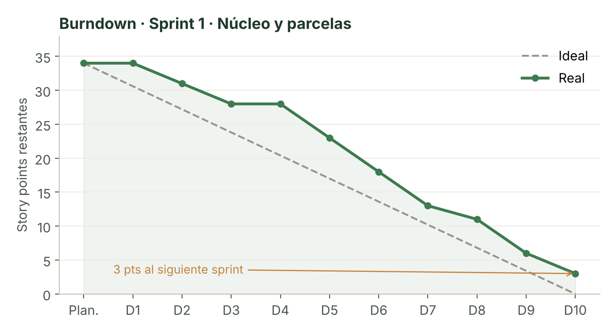

# Sprint 1 · Sprint backlog

> Trabajo individual: el responsable de todas las historias y tareas es Beymar Emilio Poma Queso.
> ✏️ **COMPLETAR:** las horas reales de cada tarea (columna "✏️ h") y las fechas del sprint.

**Objetivo del sprint:** Núcleo modular, roles y control de campo con bloqueo por carencia.
**Rama:** `sprint-1` · **Duración:** 2 semanas (10 días hábiles) · **Compromiso:** 43 puntos

## Historias

| ID | Historia | Puntos | Responsable | Estado |
|---|---|---|---|---|
| HU-01 | Como propietario quiero iniciar sesión con correo y contraseña para acceder de forma segura. | 3 | Beymar | Hecho |
| HU-02 | Como propietario quiero asignar los roles propietario, encargado y trabajador para que cada uno vea solo lo suyo. | 5 | Beymar | Hecho |
| HU-03 | Como propietario quiero activar o desactivar módulos de mi finca para pagar y usar solo lo que necesito. | 5 | Beymar | Hecho |
| HU-04 | Como encargado quiero registrar los lotes de la finca en un mapa con su campaña actual. | 5 | Beymar | Hecho |
| HU-05 | Como propietario quiero una bitácora de auditoría para saber quién hizo cada cambio. | 2 | Beymar | Hecho |
| HU-06 | Como encargado quiero un calendario de labores con responsable para organizar la semana. | 5 | Beymar | Hecho |
| HU-07 | Como encargado quiero registrar aplicaciones con producto, motivo y período de carencia. | 5 | Beymar | Hecho |
| HU-08 | Como propietario quiero que el sistema impida cosechar un lote en carencia. | 8 | Beymar | Hecho |
| HU-09 | Como trabajador quiero registrar labores y observaciones desde el celular aunque no tenga señal. | 5 | Beymar | Hecho |

## Tareas técnicas

| Tarea | Estimación (h) | Responsable | Estado |
|---|---|---|---|
| Esquema Prisma: Lote, Campania, ModuloFinca, LaborProgramada, Aplicacion (motivo, dosisEtiqueta) | ✏️ h | Beymar | Hecho |
| Middleware requiereModulo y matriz RBAC pura | ✏️ h | Beymar | Hecho |
| Rutas de lotes, campo y calendario | ✏️ h | Beymar | Hecho |
| utils/carencia.js + 409 y forzado auditado | ✏️ h | Beymar | Hecho |
| Vistas Lotes, Campo (calendario) y aviso de carencia | ✏️ h | Beymar | Hecho |
| Pruebas de carencia y RBAC | ✏️ h | Beymar | Hecho |

## Definición de terminado

- Pruebas en verde (backend y frontend) y build del frontend sin errores.
- Swagger actualizado; sin claves en el repositorio.
- Autorrevisado (diff completo, pruebas en verde) y fusionado en `sprint-1`.

