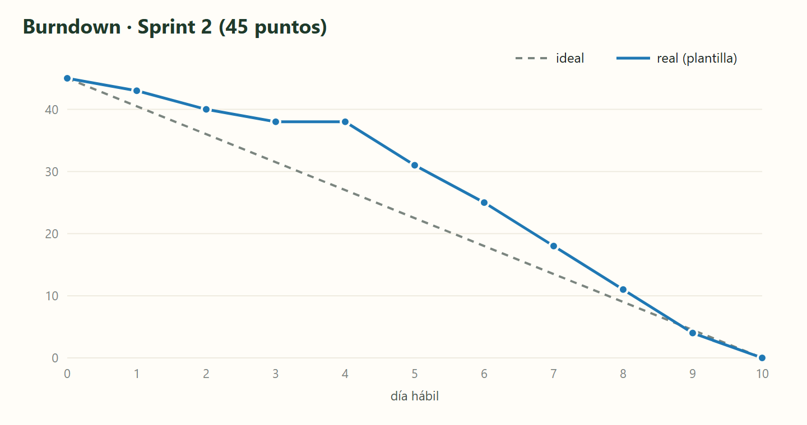

# Sprint 2 · Sprint backlog

> Fechas, responsables y horas son **plantilla**: complétenlos con su trabajo real (Jira/Trello).

**Objetivo del sprint:** Inventario, ventas, cuentas por cobrar, trazabilidad hasta la venta y tareas.
**Rama:** `sprint-2` · **Duración:** 2 semanas (10 días hábiles) · **Compromiso:** 45 puntos

## Historias

| ID | Historia | Puntos | Responsable | Estado |
|---|---|---|---|---|
| HU-10 | Como encargado quiero que la cosecha sume stock de producto y la venta lo descuente. | 5 | [Integrante] | Hecho |
| HU-11 | Como encargado quiero ver alertas de stock mínimo de insumos y productos. | 3 | [Integrante] | Hecho |
| HU-12 | Como encargado quiero registrar clientes con su consentimiento de WhatsApp. | 3 | [Integrante] | Hecho |
| HU-13 | Como encargado quiero registrar pedidos y convertirlos en ventas vinculadas al lote de cosecha. | 8 | [Integrante] | Hecho |
| HU-14 | Como propietario quiero ver cuentas por cobrar con cobros parciales y vencidos. | 5 | [Integrante] | Hecho |
| HU-15 | Como consumidor quiero escanear el QR y ver el origen del producto hasta la venta. | 8 | [Integrante] | Hecho |
| HU-16 | Como docente quiero ver la consulta SQL de trazabilidad documentada. | 3 | [Integrante] | Hecho |
| HU-17 | Como encargado quiero asignar tareas a los trabajadores y avisarles por WhatsApp si aceptaron. | 5 | [Integrante] | Hecho |
| HU-18 | Como trabajador quiero ver "Mis tareas" en el celular y marcarlas hechas. | 5 | [Integrante] | Hecho |

## Tareas técnicas

| Tarea | Estimación (h) | Responsable | Estado |
|---|---|---|---|
| Modelos de inventario de productos y ventas | [h] | [Integrante] | Hecho |
| Rutas productos, clientes, pedidos, ventas y cobros | [h] | [Integrante] | Hecho |
| Ficha pública con ventas anonimizadas y SQL documentada | [h] | [Integrante] | Hecho |
| Modelo Tarea, rutas y "Mis tareas" | [h] | [Integrante] | Hecho |
| Vistas Ventas (5 pestañas), Trabajadores → tareas | [h] | [Integrante] | Hecho |
| Entrada automática al inventario al cosechar | [h] | [Integrante] | Hecho |

## Definición de terminado

- Pruebas en verde (backend y frontend) y build del frontend sin errores.
- Swagger actualizado; sin claves en el repositorio.
- Revisado por otro integrante y fusionado en `sprint-2`.

