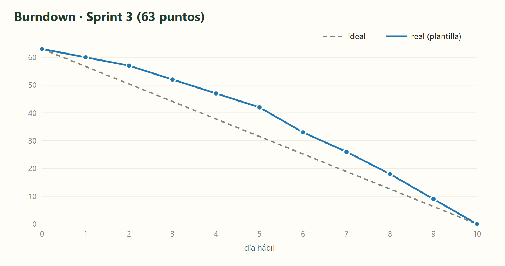

# Sprint 3 · Sprint backlog

> Trabajo individual: el responsable de todas las historias y tareas es Beymar Emilio Poma Queso.
> ✏️ **COMPLETAR:** las horas reales de cada tarea (columna "✏️ h") y las fechas del sprint.

**Objetivo del sprint:** WhatsApp real con agente ampliado, alertas, vivero, finanzas, calidad y entrega.
**Rama:** `sprint-3` · **Duración:** 2 semanas (10 días hábiles) · **Compromiso:** 63 puntos

## Historias

| ID | Historia | Puntos | Responsable | Estado |
|---|---|---|---|---|
| HU-19 | Como encargado quiero escribir "hoy cosechamos 40 kg de tomate del lote 2" por WhatsApp y que se registre tras mi SI. | 8 | Beymar | Hecho |
| HU-20 | Como encargado quiero consultar por WhatsApp pendientes, carencias, stock, ventas y cuentas por cobrar. | 5 | Beymar | Hecho |
| HU-21 | Como cliente quiero hacer un pedido por WhatsApp ("quiero 3 cajas de frutilla para el viernes"). | 5 | Beymar | Hecho |
| HU-22 | Como trabajador o cliente quiero dar o quitar mi consentimiento con ALTA / BAJA. | 3 | Beymar | Hecho |
| HU-23 | Como encargado quiero recibir cada mañana alertas de riego, aplicaciones, stock, carencia y cobros. | 5 | Beymar | Hecho |
| HU-24 | Como propietario quiero que el agente nunca recomiende dosis ni productos. | 5 | Beymar | Hecho |
| HU-25 | Como encargado quiero registrar lotes de plantines con germinación, merma y stock. | 5 | Beymar | Hecho |
| HU-26 | Como encargado quiero vender plantines desde el módulo de ventas. | 3 | Beymar | Hecho |
| HU-27 | Como propietario quiero ver el costo, el ingreso y el margen por lote. | 8 | Beymar | Hecho |
| HU-28 | Como propietario quiero exportar el reporte a CSV y verlo en gráficos. | 3 | Beymar | Hecho |
| HU-29 | Como equipo queremos pruebas automatizadas con cobertura y CI. | 8 | Beymar | Hecho |
| HU-30 | Como equipo queremos desplegar en Vercel y Render con costo mensual justificado. | 5 | Beymar | Hecho |

## Tareas técnicas

| Tarea | Estimación (h) | Responsable | Estado |
|---|---|---|---|
| Proveedor WhatsApp twilio|meta|simulado y webhook firmado | ✏️ h | Beymar | Hecho |
| Agente: cosecha, tarea hecha, pedido, consultas, políticas por perfil | ✏️ h | Beymar | Hecho |
| Alertas diarias + bitácora | ✏️ h | Beymar | Hecho |
| Vivero y reportes de finanzas con CSV | ✏️ h | Beymar | Hecho |
| Migración a Vitest, pruebas de API y CI | ✏️ h | Beymar | Hecho |
| Seed de la demo, informe, diapositivas y despliegue | ✏️ h | Beymar | Hecho |

## Definición de terminado

- Pruebas en verde (backend y frontend) y build del frontend sin errores.
- Swagger actualizado; sin claves en el repositorio.
- Autorrevisado (diff completo, pruebas en verde) y fusionado en `sprint-3`.

